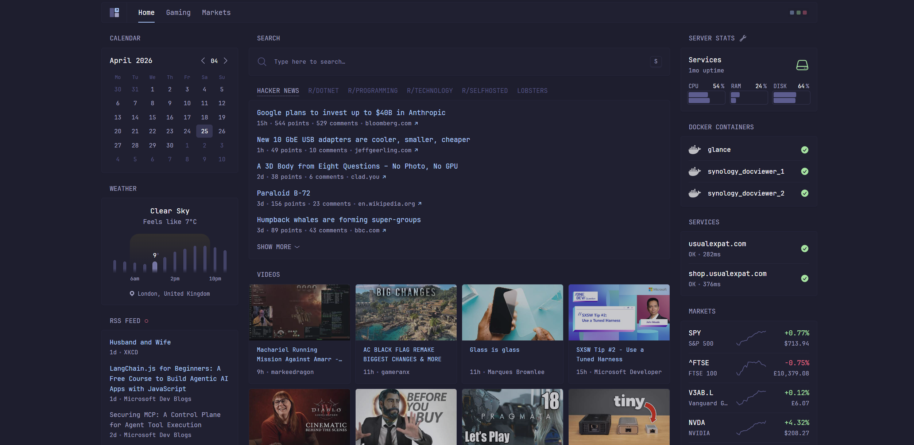
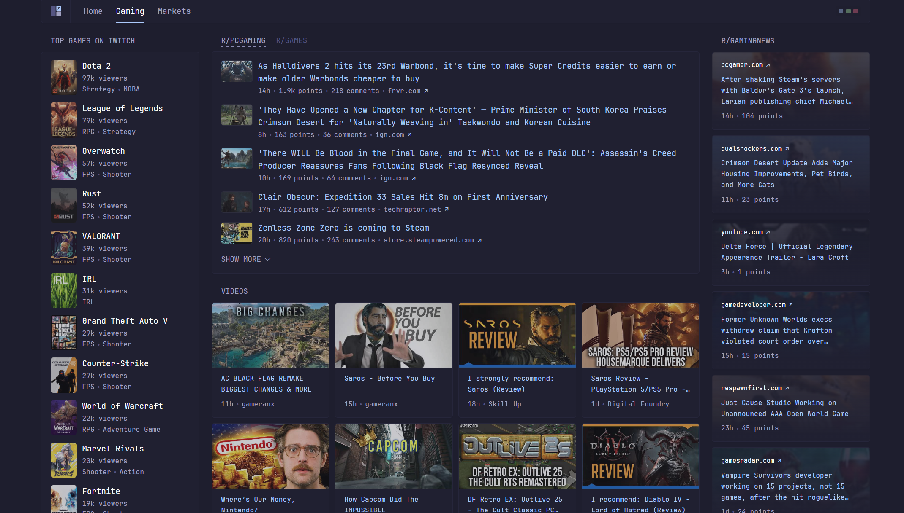
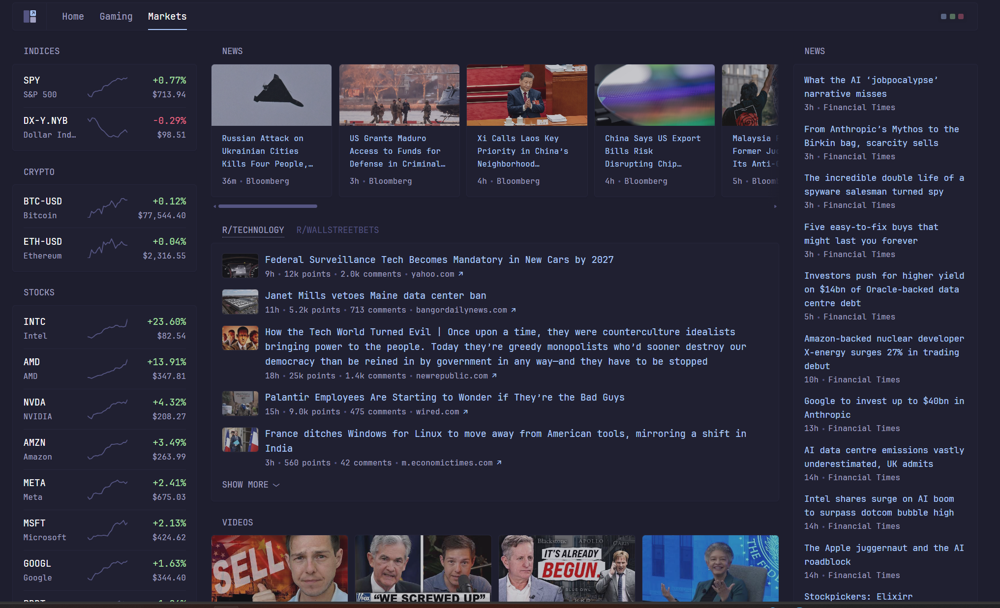

# glance-dashboard

My personal setup for Glance. Decided to wrap my slightly customised Glance dashboard in a Docker container to make it easier to manage and deploy.

## Releasing

Version is tracked in [VERSION](./VERSION). The release scripts bump it, build the image, tag both `latest` and the bumped version, and push to Docker Hub.

```bash
# Bash / Linux / macOS / WSL / Git Bash
./scripts/release.sh --patch     # 1.0.2 -> 1.0.3 (default)
./scripts/release.sh --minor     # 1.0.2 -> 1.1.0
./scripts/release.sh --major     # 1.0.2 -> 2.0.0
./scripts/release.sh --dry-run   # show the bump and exit
./scripts/release.sh --no-push   # build + tag locally, skip push
```

```powershell
# Windows / PowerShell 7+
./scripts/release.ps1 -Patch
./scripts/release.ps1 -Minor
./scripts/release.ps1 -Major
./scripts/release.ps1 -DryRun
./scripts/release.ps1 -NoPush
```

You must be logged into Docker Hub (`docker login`) before pushing. The scripts do not commit the bumped `VERSION` file — commit it manually after a successful release.

## Glance version

The base image is pinned to `glanceapp/glance:v0.8.7`. To upgrade, bump the tag in both `glance/dockerfile` and `glance/docker-compose.yml`, check the [release notes](https://github.com/glanceapp/glance/releases) for config changes, then release.

## Configuration

Pages live in `glance/config/*.yml` and are wired together by `glance.yml` via `$include`. Each page's widgets are themselves extracted into `glance/config/widgets/`, one widget per file, and pulled in with `- $include: widgets/<name>.yml`. To add a widget to a page, drop a new YAML file into `widgets/` and add an `$include` entry to the relevant page.

The theme lives in `theme.yml`, shared by both entry configs below.

## Hosting on Asgard

The same image runs on the Synology and on Asgard, with two entry configs:

| Entry config | Used by | Differences |
|---|---|---|
| `glance.yml` | Synology, local `start` scripts | No login. Home page includes server stats and Docker containers |
| `glance-asgard.yml` | Asgard, via `docker-compose.asgard.yml` | Glance's built-in login, `server.proxied: true` for Caddy, and `home-asgard.yml` without the server stats and Docker widgets |

Asgard runs it as an Arcane GitOps project from `glance/docker-compose.asgard.yml`, which follows the host's [tenant contract](https://github.com/mgpeter/usualexpat-infra/blob/main/docs/tenant-contract.md): no published ports, no Docker socket, joined to the `edge` network as `glance-web`.

### Auth secrets

```bash
./scripts/auth-secrets.sh --write      # prompts for a password, prints both values
./scripts/test-asgard.sh               # runs the Asgard config locally and checks the login
```

PowerShell equivalents: `auth-secrets.ps1 -Write` and `test-asgard.ps1`.

Set these in the Arcane project's Configuration tab:

```
STEAM_API_KEY=...
STEAM_USER=...
WEATHER_LOCATION=London
GLANCE_SECRET_KEY='...'
GLANCE_PASSWORD_HASH='$2a$10$...'
```

**Keep the single quotes on the two `GLANCE_*` values.** The hash contains `$` signs, and without quotes Compose interpolates them and the hash arrives mangled. Every login then fails as if the password were wrong.

Both values come from the environment because the config is baked into a public image: a secret key in the YAML would let anyone forge a session.

### Sessions

- A login lasts 14 days and renews itself during the last 7.
- Logging out and changing the password do **not** end existing sessions. To end them all, run `auth-secrets.sh --rotate-key`, update `GLANCE_SECRET_KEY` in Arcane and Redeploy (Restart keeps the old environment).
- Five failed logins from one IP within five minutes block that IP until the window ends.

`release.sh` validates both entry configs before tagging, so a broken `glance-asgard.yml` fails the release instead of the next Watchtower update on Asgard.

## Screens

### Main



### Gaming



### Markets



## TODO

- [ ] Setup Github Actions to build and push to Docker Hub on new releases
- [ ] Review glance community widgets
- [ ] Setup Github PAT and list personal repo links/stats
- [ ] Azure app services stats